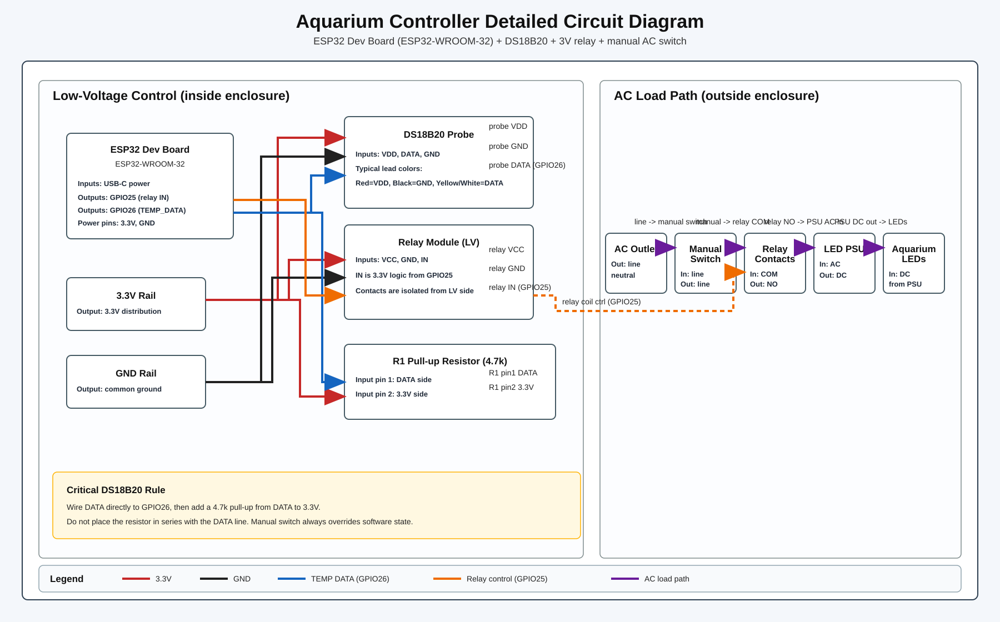

# AquariumController

ESP32 Dev Board-based smart aquarium controller (ESP32 Dev Board, ESP32-WROOM-32, CP2102, USB-C) with a simple HTTP interface for Homebridge/HomeKit integration. The controller toggles aquarium lights via a relay and reads water temperature from a DS18B20 probe. A physical manual switch remains the final authority for power to the lights.

## Project goals

- Remote control of aquarium lighting (HomeKit via Homebridge)
- Water temperature monitoring
- Safe, compact wiring with a 3D-printed enclosure

## Hardware architecture

- ESP32 Dev Board (ESP32-WROOM-32, CP2102, USB-C; PlatformIO target: `esp32dev`)
- 18x24 hole prototyping board
- 3V relay board (ESP32-driven)
- Manual on/off switch (physical override)
- DS18B20 temperature probe
- LED lighting power supply
- 5V USB power for the ESP32

Power flow (lights):

Outlet -> Manual switch -> Relay (NO) -> LED power supply -> LEDs

If the manual switch is OFF, the lights are OFF regardless of the ESP32 state.

## Pin map (current)

- Relay IN: `GPIO25`
- DS18B20 DATA: `GPIO26` (with 4.7k pull-up to 3.3V)
- Relay VCC: `3.3V`
- Relay GND: `GND`
- DS18B20 VDD: `3.3V`
- DS18B20 GND: `GND`

## Wiring details

- Relay low-voltage side: `VCC -> 3.3V`, `GND -> GND`, `IN -> GPIO25`
- DS18B20: `VDD -> 3.3V`, `GND -> GND`, `DATA -> GPIO26`, plus `4.7k DATA -> 3.3V`
- ESP32 is powered by USB-C
- Relay module mounts adjacent to the proto board in the enclosure

## Circuit diagram source of truth

The hardware wiring source of truth is the detailed circuit document:

- `docs/circuit-diagram.md`
- `docs/circuit-diagram.svg`



## Physical layout constraints

- Proto board: `70mm x 50mm` (`18x24` perfboard)
- ESP32 Dev Board: `52mm x 28.5mm x 12.5mm`
- Relay module: `70mm x 17mm x 19mm`
- Relay module is mounted adjacent in the enclosure (not flat on the same proto board surface)

## Enclosure openings (fixed orientation)

- Left wall: USB-C power cable
- Top wall: temperature probe cable
- Right wall: relay load cables (COM/NO in/out)

## Firmware behavior

The ESP32 connects to Wi-Fi, advertises mDNS, and exposes a small HTTP API:

- `GET /light/on` -> turn relay ON
- `GET /light/off` -> turn relay OFF
- `GET /light/status` -> report relay state
- `GET /temperature/c` -> read DS18B20 temperature in Celsius
- `GET /temperature/f` -> read DS18B20 temperature in Fahrenheit
- `GET /status/json` -> combined light + temperature JSON status
- `GET /homebridge/payload` -> Homebridge-oriented payload

## Wi-Fi setup

Wi-Fi details are not built into the firmware. They are entered from a phone and stored on the board, so changing networks never needs a reflash.

1. Power the board. With no saved network it broadcasts an open network called `Aquarium-Setup` right away.
2. Join `Aquarium-Setup` from a phone or laptop. The setup page opens on its own (if not, browse to `http://192.168.4.1`).
3. Pick your network (or **Other network…** for a hidden one), enter its password and tap **Connect**. The board tests the password while the setup network stays up: a wrong password or a network it cannot see sends you back with the reason, and success shows the network and the board's address and IP. The setup network closes when you tap **Done**, or after 2 minutes.

If a network is saved but the board cannot reach it, it keeps trying and opens `Aquarium-Setup` only after 10 minutes without connecting since it started, closing it again as soon as the saved network is back. A drop after the board has connected never opens it; the board just reconnects.

To switch to a different network later without touching the board, open the setup network from the current one, then set it up from a phone as above. The board stays on its current network until the new one works, and the setup network closes after 10 minutes if nothing is set up:

```
curl -X POST http://aquarium-lights.local/setup/open
```

As a last resort, hold the board's **BOOT** button for 5 seconds while it is running. It forgets the saved network and restarts into setup.

The setup page is `web/setup.html`; the build gzips it into the firmware.

Once connected, the board answers at `http://aquarium-lights.local`.

## Build and flash

Using PlatformIO:

- Test the board-independent logic on your computer: `pio test -e native`
- Build: `pio run`
- Upload over USB: `pio run -t upload` (PlatformIO finds the port; add `--upload-port <port>` if several boards are connected)
- Monitor: `pio device monitor`

The firmware uses the `min_spiffs.csv` partition layout (1.9 MB per app slot). Switching to it from the default layout needs one upload over USB; saved Wi-Fi settings are kept.

Serial settings are in `platformio.ini`.

## Updating over Wi-Fi

After one upload over USB, new firmware can be sent over Wi-Fi.

- **Password:** the board makes its own update password the first time it connects and prints it on the serial port at every start (`pio device monitor`). User name `admin`. Erasing the board's settings makes a new one.
- **Update:** build, then send the firmware with digest authentication:

  ```
  pio run
  curl --digest -u admin:<password> -F firmware=@.pio/build/esp32dev/firmware.bin http://aquarium-lights.local/update
  ```

  The board answers `Update installed, restarting` and is back within a few seconds. A wrong password gets `401` and changes nothing.
- **Rollback:** new firmware is kept only once it reconnects to Wi-Fi. If it crashes or restarts before that, or has not connected within 10 minutes, the board goes back to the previous firmware on its own.
- **Recovery:** if the board cannot reach any network, upload over USB as above.

## Contributing

See `AGENTS.md` for contribution guidance and project conventions.
