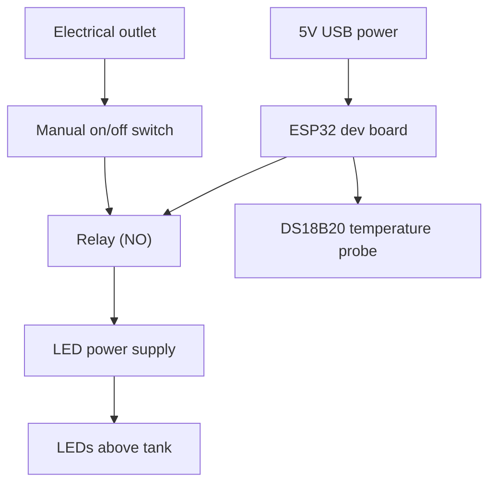

# AquariumController

ESP32-based smart aquarium controller with a simple HTTP interface for Homebridge/HomeKit integration. The controller toggles aquarium lights via a relay and is intended to read water temperature from a DS18B20 probe. A physical manual switch remains the final authority for power to the lights.

## Project goals
- Remote control of aquarium lighting (HomeKit via Homebridge)
- Water temperature monitoring
- Safe, compact wiring with a 3D‑printed enclosure

## Hardware architecture
- ESP32 dev board (PlatformIO target: `esp32cam`)
- 3V relay board (ESP32‑driven)
- Manual on/off switch (physical override)
- DS18B20 temperature probe
- LED lighting power supply
- 5V USB power for the ESP32

Power flow (lights):

Outlet → Manual switch → Relay (NO) → LED power supply → LEDs

If the manual switch is OFF, the lights are OFF regardless of ESP32 state.

## Firmware behavior
The ESP32 connects to Wi‑Fi, advertises mDNS, and exposes a small HTTP API:

- `GET /light/on` → turn relay ON
- `GET /light/off` → turn relay OFF
- `GET /light/status` → report relay state

These endpoints are intended for Homebridge to interact with the controller.

## Configuration
Wi‑Fi settings are injected at build time from `.env` using `env-extra.py`.

1) Copy the template:

```ini
# .env
WIFI_SSID=your_wifi_network_name
WIFI_PASSWORD=your_wifi_password
```

2) Build as usual; PlatformIO runs `env-extra.py` automatically.

Notes:
- `.env` is ignored by git.
- Do not hardcode credentials in source files.

## Build and flash
Using PlatformIO:

- Build: `pio run`
- Upload: `pio run -t upload`
- Monitor: `pio device monitor`

Serial port settings are configured in `platformio.ini`.

## Wiring diagram



## Contributing
See `AGENTS.md` for contribution guidance and project conventions.
