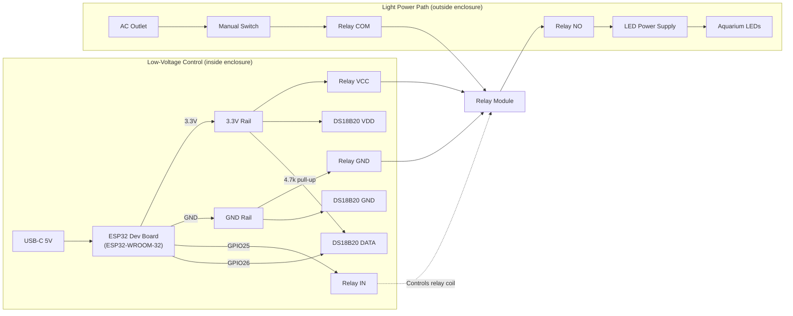

# Circuit Diagram

- ESP32 Dev Board target: ESP32-WROOM-32 (`esp32dev`)
- Relay control pin: `GPIO25`
- DS18B20 data pin: `GPIO26`
- DS18B20 pull-up: `4.7k` from `DATA` to `3.3V`

## Wiring Notes

- Manual switch remains the final authority for lights; if manual switch is OFF, lights stay OFF regardless of ESP32 state.
- The relay module sits adjacent to the proto board in the enclosure.
- Keep DS18B20 `DATA` connected directly to `GPIO26`; do not place the resistor in series.
- The 4.7k resistor must bridge `DATA` to `3.3V`.

## DS18B20 Probe Color Mapping

Use your probe vendor pinout as source-of-truth. Typical waterproof probe colors are:

- `Red` -> `VDD (3.3V)`
- `Black` -> `GND`
- `Yellow` or `White` -> `DATA`
